# REST API Diagram

These Mermaid UML API views describe the Express routes currently implemented in Tutor
Matcher. They apply the four stereotypes from the supplied **UML Profile for REST API
Design**, by Pittipol Kantavat. The PDF supplies notation and design advice; it does not
change product requirements or add routes. Product behaviour remains defined in
[user journeys](user-journeys.md), and the [application architecture](architecture.md)
shows how the API connects to the rest of the system.

Each view displays an SVG exported from its matching Mermaid (`.mmd`) source in
[`docs/diagrams/`](diagrams/). Use the source link below a view to edit it, or open
its SVG link to view the diagram at full size.

## Notation and how to read it

| Stereotype                                | Meaning in the PDF                                              | Mermaid notation used here                                                                                                                 |
| ----------------------------------------- | --------------------------------------------------------------- | ------------------------------------------------------------------------------------------------------------------------------------------ |
| `«Application»` / `<<Application>>`       | One entry point for the whole API, rooted at `/`.               | The same Tutor Matcher API class is repeated in each partial view, with `basePath = /api`.                                                 |
| `«Resource»` / `<<Resource>>`             | An addressable resource with HTTP operations.                   | A class containing only the methods actually registered at its URI. Collection and member resources are separate classes.                  |
| `«Path»` / `<<Path>>`                     | A URI fragment appended to the parent path to reach a resource. | A labelled arrow between the application or parent resource and the child resource. Fixed segments are sometimes combined for readability. |
| `«Representation»` / `<<Representation>>` | Data carried in a request or response body, usually JSON.       | A class connected by a dashed `«use»` dependency labelled request or response.                                                             |

Mermaid writes class stereotypes as `<<Application>>`, `<<Resource>>`, and
`<<Representation>>` and displays them as `«Application»`, `«Resource»`, and
`«Representation»`. `«Path»` labels belong on connections, as in the PDF; paths are
not payload classes. This is an application of the course profile, not a new profile
or a claim of an OMG REST standard (PDF pages 6–9).

Read from the application, join the `«Path»` labels, then select an operation. Add the
application's base path once. For example:

`/api` + `/bookings` + `/{id}` + `/meeting-link` + `PATCH(MeetingLinkBody)`
means `PATCH /api/bookings/{id}/meeting-link`. Express spells `{id}` as `:id`.
Query parameters appear inside operations as `name : QueryParam`, never as URI identity.
`filters` in the search operation abbreviates `tutorName`, `learningAreaId`, `minPrice`,
`maxPrice`, `minRating`, `format`, `pageSize`, and `asOf`; it is not a query key.

The number after each operation is its implemented success status. Representation names
are documentation labels; fields are selected JSON fields, not complete validation
schemas. `array of ...` describes a top-level JSON array, not an object key. Request validation, required fields, enums,
and complete response shapes remain in each linked schema, controller, and service.
A `POST()` or `PATCH()` with no argument has no required body in its route handler.

The views cover the registered `/api` endpoints. The mounted `/classroom` router is empty,
so it has no resource operation to draw. Express also has `GET /` outside this API;
it returns a greeting and is not an `/api` resource.

## Authentication and health

Sign-up, sign-in, and health are public. Current user requires a bearer token.


[Mermaid source](diagrams/api-authentication-health.mmd) · [SVG](diagrams/api-authentication-health.svg)

Source: [auth/auth.routes.ts](../apps/backend/src/modules/auth/auth.routes.ts), [auth/auth.schema.ts](../apps/backend/src/modules/auth/auth.schema.ts), [auth/auth.controller.ts](../apps/backend/src/modules/auth/auth.controller.ts), [health/health.routes.ts](../apps/backend/src/modules/health/health.routes.ts).

## Password reset

These routes are public. The existing validate route takes the reset token in the query; see the concerns below.


[Mermaid source](diagrams/api-password-reset.mmd) · [SVG](diagrams/api-password-reset.svg)

Source: [auth/auth.routes.ts](../apps/backend/src/modules/auth/auth.routes.ts), [auth/auth.schema.ts](../apps/backend/src/modules/auth/auth.schema.ts), [auth/auth.controller.ts](../apps/backend/src/modules/auth/auth.controller.ts).

## Account and Student profile

All routes require a bearer token and apply to the current user. The account update response reissues the token.


[Mermaid source](diagrams/api-account-student-profile.mmd) · [SVG](diagrams/api-account-student-profile.svg)

Source: [profile/profile.routes.ts](../apps/backend/src/modules/profile/profile.routes.ts), [profile/profile.schema.ts](../apps/backend/src/modules/profile/profile.schema.ts), [profile/profile.controller.ts](../apps/backend/src/modules/profile/profile.controller.ts).

## Tutor application and publication

All routes require a bearer token. These are the single-draft workflow routes; the next view shows the separate draft collection. Publication requires an approved Tutor.


[Mermaid source](diagrams/api-tutor-application-publication.mmd) · [SVG](diagrams/api-tutor-application-publication.svg)

Source: [profile/profile.routes.ts](../apps/backend/src/modules/profile/profile.routes.ts), [profile/profile.schema.ts](../apps/backend/src/modules/profile/profile.schema.ts), [profile/profile.service.ts](../apps/backend/src/modules/profile/profile.service.ts).

## Tutor draft collection

All routes require a bearer token and apply to the current user. Collection and member resources have separate boxes. Draft creation returns 200 in the current code.


[Mermaid source](diagrams/api-tutor-drafts.mmd) · [SVG](diagrams/api-tutor-drafts.svg)

Source: [profile/profile.routes.ts](../apps/backend/src/modules/profile/profile.routes.ts), [profile/profile.schema.ts](../apps/backend/src/modules/profile/profile.schema.ts), [profile/profile.controller.ts](../apps/backend/src/modules/profile/profile.controller.ts).

## Subjects and availability

All routes require an approved Tutor and affect that Tutor’s own subjects or slots. Dates and times are path parameters; the calendar range is a query.


[Mermaid source](diagrams/api-subjects-availability.mmd) · [SVG](diagrams/api-subjects-availability.svg)

Source: [subject/subject.routes.ts](../apps/backend/src/modules/subject/subject.routes.ts), [subject/subject.schema.ts](../apps/backend/src/modules/subject/subject.schema.ts), [availability/availability.routes.ts](../apps/backend/src/modules/availability/availability.routes.ts), [availability/availability.schema.ts](../apps/backend/src/modules/availability/availability.schema.ts).

## Tutor discovery

Search, public profiles, subject pages, learning areas, and price range are public. Optional bearer authentication personalizes search and flag markers. Only the Tutor summary at `/discovery/tutors/{id}` requires authentication.


[Mermaid source](diagrams/api-discovery.mmd) · [SVG](diagrams/api-discovery.svg)

Source: [discovery/discovery.routes.ts](../apps/backend/src/modules/discovery/discovery.routes.ts), [discovery/discovery.schema.ts](../apps/backend/src/modules/discovery/discovery.schema.ts), [discovery/discovery.controller.ts](../apps/backend/src/modules/discovery/discovery.controller.ts).

## Booking collection and detail

All routes require a bearer token. The list selects the Student or Tutor view with `role`. The two Tutor lists require the assigned Tutor.


[Mermaid source](diagrams/api-bookings.mmd) · [SVG](diagrams/api-bookings.svg)

Source: [booking/booking.routes.ts](../apps/backend/src/modules/booking/booking.routes.ts), [booking/booking.schema.ts](../apps/backend/src/modules/booking/booking.schema.ts), [booking/booking.controller.ts](../apps/backend/src/modules/booking/booking.controller.ts).

## Booking payment, completion, cancellation, and refund

All routes require a bearer token and check the caller’s relationship to the Booking. Each path below starts from the same Booking resource shown in the preceding view.


[Mermaid source](diagrams/api-booking-actions.mmd) · [SVG](diagrams/api-booking-actions.svg)

Source: [booking/booking.routes.ts](../apps/backend/src/modules/booking/booking.routes.ts), [booking/booking.schema.ts](../apps/backend/src/modules/booking/booking.schema.ts), [booking/booking.controller.ts](../apps/backend/src/modules/booking/booking.controller.ts), [refund/refund.schema.ts](../apps/backend/src/modules/refund/refund.schema.ts), [refund/refund.controller.ts](../apps/backend/src/modules/refund/refund.controller.ts).

## Wallet and top-ups

All routes require a bearer token and use the current user’s wallet. Top-up creation records a slip for Admin review; it does not immediately credit the balance.


[Mermaid source](diagrams/api-wallet-topups.mmd) · [SVG](diagrams/api-wallet-topups.svg)

Source: [wallet/wallet.routes.ts](../apps/backend/src/modules/wallet/wallet.routes.ts), [wallet/wallet.schema.ts](../apps/backend/src/modules/wallet/wallet.schema.ts), [wallet/wallet.controller.ts](../apps/backend/src/modules/wallet/wallet.controller.ts), [wallet/wallet.service.ts](../apps/backend/src/modules/wallet/wallet.service.ts), [wallet/topup.service.ts](../apps/backend/src/modules/wallet/topup.service.ts).

## Payout accounts and payouts

All routes require a Tutor and a bearer token. Saved account numbers are masked in responses. Payouts are simulated and disabled in production.


[Mermaid source](diagrams/api-payouts.mmd) · [SVG](diagrams/api-payouts.svg)

Source: [payout/payout-account.routes.ts](../apps/backend/src/modules/payout/payout-account.routes.ts), [payout/payout-account.schema.ts](../apps/backend/src/modules/payout/payout-account.schema.ts), [payout/payout-account.service.ts](../apps/backend/src/modules/payout/payout-account.service.ts), [payout/payout.routes.ts](../apps/backend/src/modules/payout/payout.routes.ts), [payout/payout.schema.ts](../apps/backend/src/modules/payout/payout.schema.ts), [payout/payout.service.ts](../apps/backend/src/modules/payout/payout.service.ts).

## Reviews, replies, and flags

All routes require a bearer token. Students review their own completed Booking; the reviewed Tutor writes or edits the reply. A member can flag a public comment. Public review reads are part of discovery.


[Mermaid source](diagrams/api-reviews.mmd) · [SVG](diagrams/api-reviews.svg)

Source: [review/review.routes.ts](../apps/backend/src/modules/review/review.routes.ts), [review/review.schema.ts](../apps/backend/src/modules/review/review.schema.ts), [review/review-reply.schema.ts](../apps/backend/src/modules/review/review-reply.schema.ts), [review/review-flag.schema.ts](../apps/backend/src/modules/review/review-flag.schema.ts).

## Messaging, notification preferences, and Tutor dashboard

All routes require a bearer token. Messaging reads are scoped to the caller; the dashboard requires an approved Tutor. The notification API currently exposes preferences, not a notification collection.


[Mermaid source](diagrams/api-messaging-notifications-dashboard.mmd) · [SVG](diagrams/api-messaging-notifications-dashboard.svg)

Source: [messaging/messaging.routes.ts](../apps/backend/src/modules/messaging/messaging.routes.ts), [messaging/messaging.schema.ts](../apps/backend/src/modules/messaging/messaging.schema.ts), [notification/notification.routes.ts](../apps/backend/src/modules/notification/notification.routes.ts), [notification/notification.schema.ts](../apps/backend/src/modules/notification/notification.schema.ts), [dashboard/dashboard.routes.ts](../apps/backend/src/modules/dashboard/dashboard.routes.ts), [dashboard/dashboard.service.ts](../apps/backend/src/modules/dashboard/dashboard.service.ts).

## Admin review queues

All routes require a bearer token and Admin access. Lists and review actions are different resources; the selected request id is part of the path.


[Mermaid source](diagrams/api-admin-review-queues.mmd) · [SVG](diagrams/api-admin-review-queues.svg)

Source: [admin/admin.routes.ts](../apps/backend/src/modules/admin/admin.routes.ts), [admin/admin.schema.ts](../apps/backend/src/modules/admin/admin.schema.ts), [admin/admin.service.ts](../apps/backend/src/modules/admin/admin.service.ts), [wallet/wallet.schema.ts](../apps/backend/src/modules/wallet/wallet.schema.ts), [wallet/topup.service.ts](../apps/backend/src/modules/wallet/topup.service.ts), [refund/refund.schema.ts](../apps/backend/src/modules/refund/refund.schema.ts), [refund/refund.service.ts](../apps/backend/src/modules/refund/refund.service.ts).

## Admin accounts and review moderation

All routes require a bearer token and Admin access. Remove requires a reason; Keep does not. Account actions suspend or ban a user.


[Mermaid source](diagrams/api-admin-accounts-moderation.mmd) · [SVG](diagrams/api-admin-accounts-moderation.svg)

Source: [admin/admin.routes.ts](../apps/backend/src/modules/admin/admin.routes.ts), [admin/admin.schema.ts](../apps/backend/src/modules/admin/admin.schema.ts), [admin/user-management.service.ts](../apps/backend/src/modules/admin/user-management.service.ts), [review/review-moderation.schema.ts](../apps/backend/src/modules/review/review-moderation.schema.ts), [review/review-moderation.service.ts](../apps/backend/src/modules/review/review-moderation.service.ts).

## Shared errors and access

Protected routes use `Authorization: Bearer <token>` and can return 401 for missing or
invalid authentication and 403 for account restrictions. Tutor, Admin, ownership, and
Booking participation checks add access rules in the handlers and services; a bearer
token alone does not grant those permissions.

Common response statuses are 400 for invalid input, 403 for forbidden access, 404 for
missing or hidden resources, 409 for a state conflict, and 429 on rate-limited routes.
Unexpected errors use 500. These are shared concerns, not a claim that every operation
returns every status. The linked handlers and services define each operation's errors.

See [authentication middleware](../apps/backend/src/middleware/auth.ts),
[request validation](../apps/backend/src/middleware/validate.ts), and
[unexpected-error handling](../apps/backend/src/middleware/error-handler.ts).

## Design concerns from the PDF

The PDF's examples and advice are distinct from the current API contract:

- **Traceability:** HTTP methods, paths, parameters, bodies, and statuses must map to
  code (pages 31–33). The diagrams preserve existing action paths such as
  `/confirm-payment`, `/tutor-cancel`, and `/review`; the PDF recommends noun-based
  resource paths (pages 22–23). Renaming those routes would require a separate change.
- **Identity and view:** path parameters identify a resource; queries filter, sort, or
  paginate a view (pages 13 and 24–26). Body data belongs in representations, and bearer
  tokens belong in the Authorization header. The reset validation route currently uses
  a token query parameter, which differs from the PDF's advice to keep secrets out of
  URLs (pages 14 and 26).
- **Nesting:** nested paths should express a meaningful relationship and avoid excessive
  depth (pages 27–28). Existing profile workflow paths are deeper than the example's
  advice; they are documented as implemented.
- **Base path:** define the API prefix on `«Application»` once (page 30). This backend
  mounts `/api`, not the example's `/api/v1`; no API version is invented here.
- **Methods and retries:** GET should be safe and idempotent; POST retries can repeat a
  write, PUT replaces a representation, PATCH changes part of it, and DELETE removes
  a resource (pages 12–17). Those are design expectations, not proof of current runtime
  behaviour. Some existing PUT profile routes perform partial updates, and wallet reads
  can settle eligible earnings. Callers must follow the implemented contract.
- **Responses:** show actual statuses and bodies (page 18). Creation often returns 201,
  but the current Tutor draft creation returns 200. DELETE currently returns JSON with 200. The PDF recommends a Location header for 201; the current create handlers do not
  set one. The diagrams do not imply that they do.

Notation reference: supplied `UML_Profile_REST_API_Design-360766-17893667244803.pdf`,
particularly pages 8, 18, 20–21, 24–28, and 30–34. The original remains at the supplied
local path; it has not been changed or copied into the repository.

## Source map and maintenance

The API prefix comes from [app.ts](../apps/backend/src/app.ts), and public/protected
mounts come from [routes.ts](../apps/backend/src/routes.ts). Each view links its route
file and payload sources. When a route changes, follow those mounts, update the affected
resource operation and representations in its linked `.mmd` file, regenerate the matching
`.svg`, and check the full path in both directions. Commit both files together. Initialize
Mermaid with the shared [render settings](diagrams/mermaid-config.json), including the
default theme, classic look, Dagre layout, Arial font, and native SVG text. The legacy
`flowchart.htmlLabels` setting also disables HTML in classic class-diagram edge labels.
The SVGs were rendered with Mermaid 12.3.0 on a white background; they do not need Mermaid
to display. Keep `xml:space="preserve"` on each exported SVG root so labels retain spaces
across viewers.

These are source-based documentation views, not evidence of a live deployment or a
complete OpenAPI schema. See [testing](testing.md) for implementation checks.
