# Application Architecture

This page describes the application structure present in the repository. The
frontend and backend are separate applications in one repository. The frontend
handles pages and the user interface. Browser data requests use the Express API. Backend domain
modules own route handlers and business logic, with Prisma providing database
access.

A component is a group of related application functions.
An API is an interface for application requests.
This C4 view expands the Express backend into components.
Some boxes group related source modules to keep the diagram readable.

## C4 component view

```mermaid
C4Component
  title Tutor Matcher application components

  Person(user, "Student, Tutor, or Admin", "Uses the web application")

  System_Boundary(tutorMatcher, "Tutor Matcher") {
    Container(frontend, "Web application", "Next.js, TypeScript, Tailwind CSS", "Pages and user interface. Browser requests /api on the same origin")

    Container_Boundary(apiBoundary, "Express API") {
      Component(http, "HTTP application and router", "Express", "Mounts /api routes, public routes, authentication middleware, validation, and error handling")
      Component(auth, "Authentication", "auth module", "Sign-up, sign-in, password reset, and bearer-token authentication")
      Component(admin, "Administration", "admin module", "Tutor application, top-up, and account administration")
      Component(profile, "Profiles, subjects, and availability", "profile, subject, availability modules", "Account and tutor profile workflows, subjects, and tutor availability")
      Component(discovery, "Tutor discovery", "discovery module", "Public and authenticated tutor discovery")
      Component(booking, "Bookings", "booking module", "Booking lifecycle and coordination with wallet, notifications, profile, subject, and refund logic")
      Component(dashboard, "Dashboard", "dashboard module", "Dashboard data")
      Component(classroom, "Classroom route", "classroom module", "Empty route with a placeholder service")
      Component(money, "Wallet and payouts", "wallet, payout modules", "Wallet ledger and payout operations")
      Component(refund, "Refund requests", "refund module", "Student refund requests and admin decisions")
      Component(reviews, "Reviews", "review module", "Review submissions, replies, visibility, and flags")
      Component(messaging, "Messaging", "messaging module", "Message routes and business logic")
      Component(notifications, "Notifications", "notification module", "In-app notification routes and business logic")
      Component(health, "Health endpoint", "health module", "API health route")
      Component(email, "Email delivery adapter", "shared email library", "Logs reset links in log mode or sends password reset emails through Resend")
      Component(persistence, "Database access", "Prisma Client with PostgreSQL adapter", "Shared database client used by backend services")
    }
  ContainerDb(postgres, "Application database", "PostgreSQL", "Users, profiles, bookings, wallet records, reviews, and related application data")
  }

  System_Ext(resend, "Resend", "Email delivery provider")

  Rel(user, frontend, "Uses", "HTTPS")
  Rel(frontend, http, "Calls /api routes through Next.js rewrites", "HTTP / JSON")
  Rel(http, auth, "Routes public /auth and protects private routes")
  Rel(http, admin, "Routes /admin")
  Rel(http, profile, "Routes /profiles, including subject and availability subroutes")
  Rel(http, discovery, "Routes public and protected /discovery")
  Rel(http, booking, "Routes /bookings")
  Rel(http, classroom, "Routes /classroom")
  Rel(http, dashboard, "Routes /dashboard")
  Rel(http, money, "Routes /wallet, /payout-accounts, and /payouts")
  Rel(http, refund, "Routes booking refund requests and admin refund decisions")
  Rel(http, reviews, "Routes /reviews")
  Rel(http, messaging, "Routes /messages")
  Rel(http, notifications, "Routes /notifications")
  Rel(http, health, "Routes /health")
  Rel(auth, email, "Requests password reset email delivery")
  Rel(booking, money, "Uses wallet ledger operations")
  Rel(booking, notifications, "Sends in-app notifications")
  Rel(booking, profile, "Reads profile projections and subject snapshots")
  Rel(booking, refund, "Uses refund policy and request operations")
  Rel(admin, refund, "Provides admin refund decision routes")
  Rel(auth, persistence, "Reads and writes account and reset data")
  Rel(admin, persistence, "Reads and writes application data")
  Rel(profile, persistence, "Reads and writes profile data")
  Rel(discovery, persistence, "Reads discovery data")
  Rel(booking, persistence, "Reads and writes booking data")
  Rel(dashboard, persistence, "Reads dashboard data")
  Rel(money, persistence, "Reads and writes wallet and payout data")
  Rel(refund, persistence, "Reads and writes refund data")
  Rel(reviews, persistence, "Reads and writes review data")
  Rel(messaging, persistence, "Reads and writes message data")
  Rel(notifications, persistence, "Reads and writes notification data")
  Rel(persistence, postgres, "Uses Prisma PostgreSQL adapter", "PostgreSQL connection")
  Rel(email, resend, "Sends password reset emails when delivery mode is resend", "Resend API")
```

## Boundaries and behavior

- The frontend is a Next.js App Router application. It makes browser
  requests to `/api/*`. `next.config.ts` sends those paths to the Express
  backend. The browser does not need a separate API origin.
- The backend is a standalone Express application. `app.ts` mounts the
  main router at `/api`. `routes.ts` separates public endpoints from
  routes protected by bearer-token authentication.
- Backend domain modules group routes, controllers, business services,
  and request schemas. Subject and availability routes are mounted under
  the profile router. Booking and admin operations use refund logic.
- Backend services share one Prisma client configured with the PostgreSQL
  adapter. The services, rather than the frontend, access the database.
- The email adapter supports logging reset URLs for local development and
  sending reset emails through Resend when configured. The classroom service is
  currently a placeholder. The booking module stores and updates meeting links.
  The current code does not call the Google Meet API.

## Evidence

- [Repository architecture and data flow](../README.md#architecture)
- [Separate Express backend decision](adr/0001-separate-express-backend.md)
- [Frontend and backend monorepo decision](adr/0002-monorepo-layout.md)
- [Express application and API mount](../apps/backend/src/app.ts)
- [API route aggregation and access boundaries](../apps/backend/src/routes.ts)
- [Frontend API rewrite](../apps/frontend/next.config.ts)
- [Backend module ownership convention](../apps/backend/src/modules/README.md)
- [Shared Prisma PostgreSQL client](../apps/backend/src/lib/db.ts)
- [Profile routes mounting subject and availability](../apps/backend/src/modules/profile/profile.routes.ts)
- [Booking service domain dependencies](../apps/backend/src/modules/booking/booking.service.ts)
- [Booking routes and refund request integration](../apps/backend/src/modules/booking/booking.routes.ts)
- [Admin routes and refund review integration](../apps/backend/src/modules/admin/admin.routes.ts)
- [Email delivery adapter](../apps/backend/src/lib/email.ts)
- [Classroom service](../apps/backend/src/modules/classroom/classroom.service.ts)
