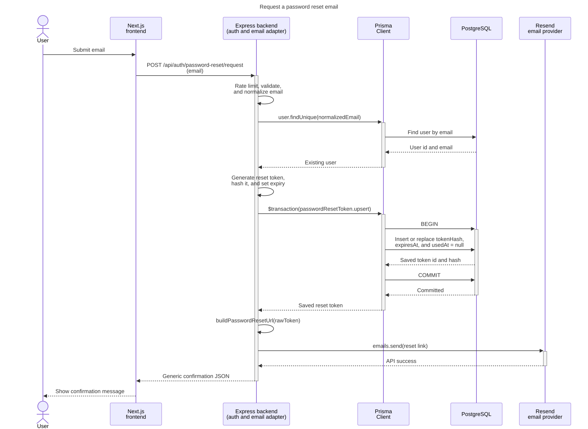
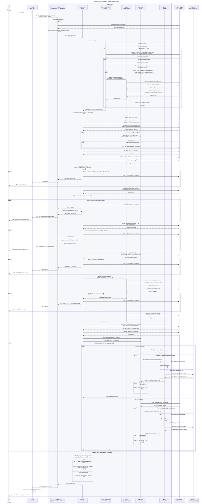

# Application Architecture

This page describes the application structure present in the repository. The
frontend and backend are separate applications in one repository. The frontend
handles pages and the user interface. Browser data requests use the Express API. Backend domain
modules own route handlers and business logic, with Prisma providing database
access.

A component is a group of related application functions.
An API is an interface for application requests.
This C4 view expands the Express backend into components.
Some boxes group related source modules to keep the diagram readable.

## C4 component view

```mermaid
C4Component
  title Tutor Matcher application components

  Person(user, "Student, Tutor, or Admin", "Uses the web application")

  System_Boundary(tutorMatcher, "Tutor Matcher") {
    Container(frontend, "Web application", "Next.js, TypeScript, Tailwind CSS", "Pages and user interface. Browser requests /api on the same origin")

    Container_Boundary(apiBoundary, "Express API") {
      Component(http, "HTTP application and router", "Express", "Mounts /api routes, public routes, authentication middleware, validation, and error handling")
      Component(auth, "Authentication", "auth module", "Sign-up, sign-in, password reset, and bearer-token authentication")
      Component(admin, "Administration", "admin module", "Tutor application, top-up, and account administration")
      Component(profile, "Profiles, subjects, and availability", "profile, subject, availability modules", "Account and tutor profile workflows, subjects, and tutor availability")
      Component(discovery, "Tutor discovery", "discovery module", "Public and authenticated tutor discovery")
      Component(booking, "Bookings", "booking module", "Booking lifecycle and coordination with wallet, notifications, profile, subject, and refund logic")
      Component(dashboard, "Dashboard", "dashboard module", "Dashboard data")
      Component(classroom, "Classroom route", "classroom module", "Empty route with a placeholder service")
      Component(money, "Wallet and payouts", "wallet, payout modules", "Wallet ledger and payout operations")
      Component(refund, "Refund requests", "refund module", "Student refund requests and admin decisions")
      Component(reviews, "Reviews", "review module", "Review submissions, replies, visibility, and flags")
      Component(messaging, "Messaging", "messaging module", "Message routes and business logic")
      Component(notifications, "Notifications", "notification module", "In-app notification routes and business logic")
      Component(health, "Health endpoint", "health module", "API health route")
      Component(email, "Email delivery adapter", "shared email library", "Logs reset links in log mode or sends password reset emails through Resend")
      Component(persistence, "Database access", "Prisma Client with PostgreSQL adapter", "Shared database client used by backend services")
    }
  ContainerDb(postgres, "Application database", "PostgreSQL", "Users, profiles, bookings, wallet records, reviews, and related application data")
  }

  System_Ext(resend, "Resend", "Email delivery provider")

  Rel(user, frontend, "Uses", "HTTPS")
  Rel(frontend, http, "Calls /api routes through Next.js rewrites", "HTTP / JSON")
  Rel(http, auth, "Routes public /auth and protects private routes")
  Rel(http, admin, "Routes /admin")
  Rel(http, profile, "Routes /profiles, including subject and availability subroutes")
  Rel(http, discovery, "Routes public and protected /discovery")
  Rel(http, booking, "Routes /bookings")
  Rel(http, classroom, "Routes /classroom")
  Rel(http, dashboard, "Routes /dashboard")
  Rel(http, money, "Routes /wallet, /payout-accounts, and /payouts")
  Rel(http, refund, "Routes booking refund requests and admin refund decisions")
  Rel(http, reviews, "Routes /reviews")
  Rel(http, messaging, "Routes /messages")
  Rel(http, notifications, "Routes /notifications")
  Rel(http, health, "Routes /health")
  Rel(auth, email, "Requests password reset email delivery")
  Rel(booking, money, "Uses wallet ledger operations")
  Rel(booking, notifications, "Sends in-app notifications")
  Rel(booking, profile, "Reads profile projections and subject snapshots")
  Rel(booking, refund, "Uses refund policy and request operations")
  Rel(admin, refund, "Provides admin refund decision routes")
  Rel(auth, persistence, "Reads and writes account and reset data")
  Rel(admin, persistence, "Reads and writes application data")
  Rel(profile, persistence, "Reads and writes profile data")
  Rel(discovery, persistence, "Reads discovery data")
  Rel(booking, persistence, "Reads and writes booking data")
  Rel(dashboard, persistence, "Reads dashboard data")
  Rel(money, persistence, "Reads and writes wallet and payout data")
  Rel(refund, persistence, "Reads and writes refund data")
  Rel(reviews, persistence, "Reads and writes review data")
  Rel(messaging, persistence, "Reads and writes message data")
  Rel(notifications, persistence, "Reads and writes notification data")
  Rel(persistence, postgres, "Uses Prisma PostgreSQL adapter", "PostgreSQL connection")
  Rel(email, resend, "Sends password reset emails when delivery mode is resend", "Resend API")
```

## Sequence: Request a password reset email

This short use case shows the frontend, backend, Prisma Client, PostgreSQL, and Resend.
It follows a valid request for an existing account, within the request rate limit,
with email delivery configured as `resend` and the provider call succeeding.

[Mermaid source](diagrams/sequence-password-reset-email.mmd) ·
[SVG](diagrams/sequence-password-reset-email.svg)

The frontend submits the email. The backend validates and normalizes it, finds the user
through Prisma, generates a reset token, and saves its hash and expiry in a transaction.
The email adapter sends the reset link through Resend after that transaction commits.
The backend returns a generic confirmation, and the frontend displays it. Resend API
success confirms the send request succeeded; the diagram does not track inbox delivery.

The backend lifeline groups middleware, the auth controller and service, and the email
adapter. Prisma Client is a library inside that backend process, shown separately to make
database access visible. Each database message describes a Prisma operation; generated
SQL is outside the view. The transaction replaces an existing reset token for the user or
creates one. The raw token is used in the reset link; its hash is stored in the database.

Other outcomes stay outside this short successful path: an unknown email receives the
same generic confirmation without sending an email, and an email-send failure removes
the matching saved token before propagating the error. Opening the link and setting a new
password belong to later requests.

Sources: [Forgot-password page](../apps/frontend/app/forgot-password/page.tsx),
[auth route and rate limit](../apps/backend/src/modules/auth/auth.routes.ts),
[auth controller](../apps/backend/src/modules/auth/auth.controller.ts),
[reset request service](../apps/backend/src/modules/auth/auth.service.ts),
[Prisma client](../apps/backend/src/lib/db.ts), and
[email adapter](../apps/backend/src/lib/email.ts).

The expanded booking-payment sequence below provides the more detailed view. Both
sequences have separate `.mmd` sources and `.svg` exports in `docs/diagrams/` and use the
shared [render settings](diagrams/mermaid-config.json).

## Sequence: Student pays for a booking

This single use case follows a Student's booking-payment request through the Next.js
web app, Express middleware and services, Prisma/PostgreSQL, and email delivery.
The caller starts signed in with a pending Booking. The sequence includes guarded
branches for Tutor earnings, expired requests, payment failures, and notification settings.

[Mermaid source](diagrams/sequence-booking-payment.mmd) ·
[SVG](diagrams/sequence-booking-payment.svg)

The browser sends `POST /api/bookings/{id}/confirm-payment` through the Next.js API rewrite.
The HTTP layer groups middleware, routing, and the controller. It verifies the bearer token,
checks account restrictions, and validates the Booking id before calling the Booking service.
The diagram starts with valid authentication and request parameters; it expands the payment
failure paths after that point.

The earning settlement service first checks whether the payer is also a Tutor. It checks
candidate completed lessons and their payment, earning, and refund records again inside
each lesson's transaction. An eligible lesson credits the net earning and appends one
`LESSON_EARNING` row. The Booking service then runs expired-payment cleanup, including
legacy slot-link cleanup and conditional cancellation of the selected expired request.
These transactions commit before the new payment transaction starts.

The payment transaction reads and validates the Booking and slots, claims each slot,
confirms the Booking, debits the wallet, and appends a `LESSON_PAYMENT` row. The diagram
shows separate calls and returns for these reads and writes. A validation or debit failure
rolls back this payment transaction; earlier earning settlement and cleanup stay committed.
The slot-conflict response also calls `getSubjectAvailability` to refresh the available times.

After payment commits, Student and Tutor notification attempts start independently. Each
attempt reads that recipient's preferences and calls the email adapter when enabled. The
adapter either logs the update or calls Resend. The request races the notification promises
against a 1000 ms timer. Its response appears inside that parallel branch, so it can return
even while a slow notification is still running. Email delivery failures are caught;
rejected lookups are consumed and logged without recipient data by `Promise.allSettled`.
Neither failure undoes the committed payment.

Backend participants are modules in one Express application; their calls are function calls.
The database lifeline groups Prisma and PostgreSQL. `BEGIN`, `COMMIT`, and `ROLLBACK` label
transaction operations managed by Prisma. The sequence expands application interactions,
while leaving SQL generated by Prisma and concurrency retry attempts out of view. Earning
transactions allow up to three attempts, and cleanup and payment allow up to two attempts;
the payment handler also checks the latest Booking status after a serialization conflict.
The refreshed-availability helper's internal queries are outside the payment path shown.

Solid filled arrows show calls that are awaited, dashed arrows show returns, and solid
open arrows start the two notification promises without waiting for either to settle.
Activation bars show request handling and the main transaction. `opt` and `alt` mark
conditions, `loop` repeats earning checks, `break` ends a failed payment request, and `par`
shows independent work. These follow the supplied behavioral-modeling PDF's notation
(pages 5–12); the flow itself comes from the [booking journey](user-journeys.md#step-2--payment-due-bookingsid)
and the current code:

- [Frontend payment request](../apps/frontend/src/lib/bookings-api.ts) and
  [confirmation display](../apps/frontend/app/bookings/[id]/page.tsx)
- [Authentication and restrictions](../apps/backend/src/middleware/auth.ts),
  [account restriction query](../apps/backend/src/modules/admin/account-actions.ts), and
  [request validation](../apps/backend/src/middleware/validate.ts)
- [Booking route](../apps/backend/src/modules/booking/booking.routes.ts),
  [controller](../apps/backend/src/modules/booking/booking.controller.ts), and
  [payment and expired-request transactions](../apps/backend/src/modules/booking/booking.service.ts)
- [Earning settlement](../apps/backend/src/modules/wallet/earning-settlement.service.ts),
  [wallet ledger helper](../apps/backend/src/modules/wallet/wallet-ledger.ts), and
  [serializable transaction helper](../apps/backend/src/lib/serializable.ts)
- [Notification service](../apps/backend/src/modules/notification/notification.service.ts)
  and [email adapter](../apps/backend/src/lib/email.ts)

Edit the `.mmd` source and regenerate its `.svg` with the shared
[render settings](diagrams/mermaid-config.json). Commit both files together, as for the
[API diagrams](api-diagram.md#source-map-and-maintenance).

## Boundaries and behavior

- The frontend is a Next.js App Router application. It makes browser
  requests to `/api/*`. `next.config.ts` sends those paths to the Express
  backend. The browser does not need a separate API origin.
- The backend is a standalone Express application. `app.ts` mounts the
  main router at `/api`. `routes.ts` separates public endpoints from
  routes protected by bearer-token authentication.
- Backend domain modules group routes, controllers, business services,
  and request schemas. Subject and availability routes are mounted under
  the profile router. Booking and admin operations use refund logic.
- Backend services share one Prisma client configured with the PostgreSQL
  adapter. The services, rather than the frontend, access the database.
- The email adapter supports logging reset URLs for local development and
  sending reset emails through Resend when configured. The classroom service is
  currently a placeholder. The booking module stores and updates meeting links.
  The current code does not call the Google Meet API.

## Evidence

- [Repository architecture and data flow](../README.md#architecture)
- [Separate Express backend decision](adr/0001-separate-express-backend.md)
- [Frontend and backend monorepo decision](adr/0002-monorepo-layout.md)
- [Express application and API mount](../apps/backend/src/app.ts)
- [API route aggregation and access boundaries](../apps/backend/src/routes.ts)
- [Frontend API rewrite](../apps/frontend/next.config.ts)
- [Backend module ownership convention](../apps/backend/src/modules/README.md)
- [Shared Prisma PostgreSQL client](../apps/backend/src/lib/db.ts)
- [Profile routes mounting subject and availability](../apps/backend/src/modules/profile/profile.routes.ts)
- [Booking service domain dependencies](../apps/backend/src/modules/booking/booking.service.ts)
- [Booking routes and refund request integration](../apps/backend/src/modules/booking/booking.routes.ts)
- [Admin routes and refund review integration](../apps/backend/src/modules/admin/admin.routes.ts)
- [Email delivery adapter](../apps/backend/src/lib/email.ts)
- [Classroom service](../apps/backend/src/modules/classroom/classroom.service.ts)
