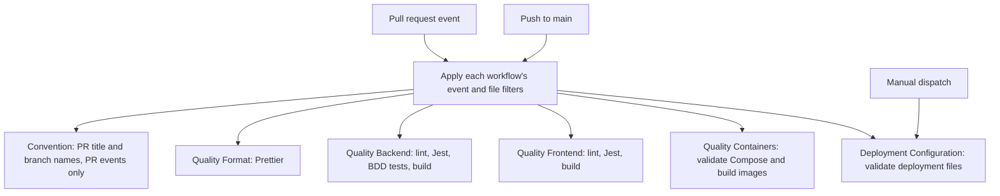
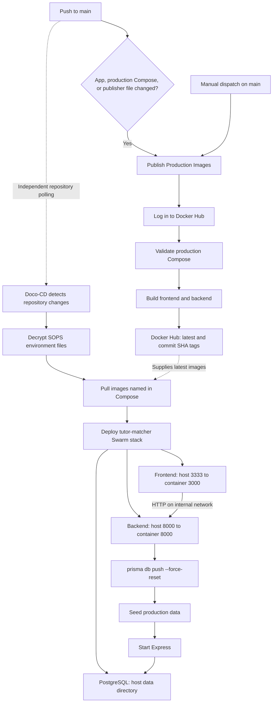

# CI/CD and deployment

Continuous integration (CI) runs tests and builds after code changes.
Continuous deployment (CD) updates the running application from repository changes.
These diagrams describe repository configuration. They do not prove that the live deployment uses this configuration.

## Tests and builds

A pull request (PR) proposes a change for review.
Each workflow runs independently when its event and file filters match.
The quality workflows also run on matching pushes to `main`.

The backend workflow runs behavior tests through `test:bdd` after Jest.
The container workflow builds images without publishing them.
The deployment validation workflow tests image names, service addresses, ports, and environment file paths.
The workflow files do not establish which results the repository requires before a merge.

The source files define the exact triggers and steps:

- [Convention](../.github/workflows/convention.yml)
- [Quality Format](../.github/workflows/quality-format.yml)
- [Quality Backend](../.github/workflows/quality-backend.yml)
- [Quality Frontend](../.github/workflows/quality-frontend.yml)
- [Quality Containers](../.github/workflows/quality-container.yml)
- [Deployment Configuration](../.github/workflows/deployment.yml)
- [Deployment validation script](../.github/scripts/validate-deploy-compose.sh)

## Image publishing and deployment

An image packages an application for a container.
A Swarm stack groups services on Docker hosts.
The publisher and Doco-CD run separately. The publisher does not wait for the quality workflows.

The [publisher](../.github/workflows/publish-production-images.yml) runs for matching changes under `apps/backend/`, `apps/frontend/`, `deploy/compose.yaml`, or its own workflow file.
It pushes `latest` and commit SHA tags for both applications.
A SHA identifies a Git commit. Production Compose selects the `latest` tags.
No workflow dependency orders image publishing before Doco-CD polling.

[.doco-cd.yaml](../.doco-cd.yaml) selects `deploy/compose.yaml` and enables image pulling.
[ADR 0003](adr/0003-docker-compose-deployment.md) describes polling `main` and deployment through Swarm.
The [deployment guide](../deploy/README.md) describes decryption of SOPS environment files before deployment.

[Production Compose](../deploy/compose.yaml) defines one replica for each service.
The frontend build uses `BACKEND_URL=http://backend:8000`.
PostgreSQL stores data at `/srv/platform/tutor-matcher/postgres` on the host.
Service updates stop the old task first and select rollback on update failure.

The backend startup command resets the configured database, seeds data, and starts Express.
The reset can delete stored data each time a backend task starts.
The exact command is `npm run db:push -- --force-reset && npm run db:seed:prod && npm start`.
See the [backend scripts](../apps/backend/package.json) for each command.

Live workflow results, registry images, Doco-CD logs, and running services require separate inspection.
This documentation task does not test those systems.
