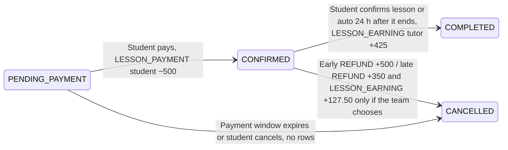

# Implementation guide: wallet ledger

**For:** whoever implements the wallet and the booking money changes · **Date:** 2026-10-12 · **Based on:** `main` at `769d102`  
**Why this design:** see *Decision: wallet money is an append-only ledger*.

## Rules

1. **Write a wallet row only when money actually moves.** Rows are never updated or deleted.
2. **One shared wallet function is the only thing that changes `users.balance`,** and it always writes the row in the same step.
3. **A money row and the booking status change that causes it go in one DB transaction.** If either fails, neither happens.

## Table: `wallet_transactions`

| Column | Type | Meaning |
|---|---|---|
| `wallet_transaction_id` | UUID, PK | |
| `type` | enum | `TOP_UP`, `LESSON_PAYMENT`, `LESSON_EARNING`, `REFUND`, `PAYOUT` |
| `amount` | NUMERIC(12,2) | Always positive. The type gives the sign: + for `TOP_UP`, `LESSON_EARNING`, `REFUND`; − for `LESSON_PAYMENT`, `PAYOUT` |
| `balance_after` | NUMERIC(12,2) | The user's balance right after this row |
| `created_at` | TIMESTAMP | When the money moved |
| `user_id` | FK → users | Whose wallet |
| `booking_id` | FK → bookings, NULL | Set for lesson payment, lesson earning, refund; NULL for top-up and payout |

**Constraints:** UNIQUE (`booking_id`, `type`), so a booking has at most one lesson payment, one lesson earning and one refund. INDEX (`user_id`, `created_at`) for the wallet list.

**Removed:** the `payments` table, `PaymentType`, `PaymentStatus`.

## Settings

Named env settings with defaults, not numbers written in the code: **platform fee 15%**, **lesson clearing 24 h**, **late refund 70%**, **cancellation window 24 h** (the last two already exist). All of them still need product sign-off.

When splitting money, compute one part with the rate and get the other as **total − part**, so the parts always add up exactly.

## Booking flow

*500 THB booking, 15% fee, 70% late refund. Arrows are booking status changes; labels are the action and the wallet rows written in the same transaction.*

## What each action does to the DB

| Action | Booking status | Wallet rows written | Balance |
|---|---|---|---|
| Top-up | none | `TOP_UP` | + amount |
| Create booking | → `PENDING_PAYMENT` | none; the amount due is `bookings.total_amount` | no change |
| Pay | `PENDING_PAYMENT` → `CONFIRMED` | `LESSON_PAYMENT` on the student | student − total |
| Lesson confirmed by the student, or 24 h after it ends | `CONFIRMED` → `COMPLETED` | `LESSON_EARNING` on the tutor (total − fee) | tutor + lesson earning |
| Unpaid booking expires or is cancelled | → `CANCELLED` | none | no change |
| Paid booking cancelled early | `CONFIRMED` → `CANCELLED` | `REFUND` 100% | student + total |
| Paid booking cancelled late | `CONFIRMED` → `CANCELLED` | `REFUND` 70%; plus a tutor `LESSON_EARNING` only if the team chooses | student + refund |
| Payout | none | `PAYOUT` | − amount |

**When something fails, nothing is written.** A failed top-up or payout, or a payment with too little balance, leaves no row and no balance change, and the booking keeps its status.

## DB behaviour to get right

- **Debits are conditional:** subtract only if the balance is at least the amount, in a single statement. Otherwise reject. Two payments sent at the same moment can't push a balance below zero.
- **Status changes are conditional:** change the status only from the expected one (e.g. only `CONFIRMED` → `COMPLETED`). If another request already moved it, do nothing. This makes double clicks, retries and the auto-complete safe.
- **The unique (`booking_id`, `type`) constraint** is the last guard against charging or crediting twice.
- **Zero amounts write no row** (e.g. a 0% refund).
- **Auto-complete runs lazily** before booking and wallet reads, the same way `releaseExpiredBookings` already handles expired payments.

## What `/wallet` shows

| Number | Where it comes from |
|---|---|
| Available balance | `users.balance` |
| Pending earnings | The tutor's `CONFIRMED` bookings, total − fee each (calculated, not stored) |
| Earnings this month | Sum of the user's `LESSON_EARNING` rows this month |
| All-time paid out | Sum of the user's `PAYOUT` rows |
| Transaction list | The user's rows, newest first, filterable by type |

Unpaid bookings don't appear in the wallet; they're on `/bookings` as payment due.

## Checks that must always hold

- No balance is ever below 0.
- For each user: `users.balance` = sum of their signed rows, and their newest `balance_after` equals it.
- For each booking: lesson payment = refund + lesson earning + the platform's part.
- Whole system: top-ups − payouts = all balances + money held for `CONFIRMED` bookings + platform revenue.

## Areas that change

Prisma schema and seed · the wallet module (top-up, payout, wallet page) · booking service (create, pay, cancel, payment-expiry sweep, cancellation quote) · a new "confirm lesson" action · booking tests · `docs/database-schema.md`, `docs/user-journeys.md` §4, `CONTEXT.md`.

## Still open

- **Late cancellation share:** does the tutor get part of what the student loses? Until it's decided, build without it.
- **Final numbers** for the fee, clearing time, late refund rate and cancellation window.
- **Disputes:** reporting a lesson that didn't happen, before auto-complete runs.
